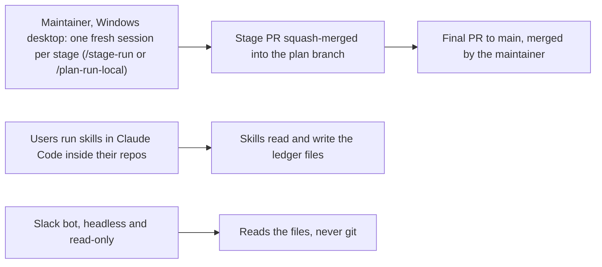
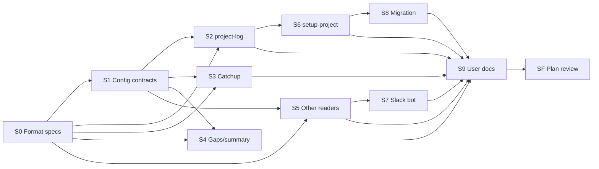

Generated from PLAN.md @ 4245fa5bb659 — do not edit
# Replace the ledger with DECISIONS.md, open.md and git history — plan brief

> One page to check this plan against what you expect. Feedback goes in chat
> (or as comments on the artifact): it is applied to `PLAN.md`, and this brief
> is regenerated from it.

## Outcome

*From `PLAN.md` › Requirements › Outcome.*

A project's ledger stops being an append-only log and becomes a record of what is true now: `DECISIONS.md` at each repository root and `.daikenja/open.md` in the home repository, with git holding the history. Every project lives in a git repository, so pathless projects go. Skills and the Slack bot read the new files; `project-log` writes them in one approved batch; existing ledgers migrate with your approval and a dated backup.

## Day to day

*From `PLAN.md` › Requirements › Day to day.*

## Constraints and out of scope

*From `PLAN.md` › Requirements › Constraints and Out of scope.*

**Constraints, ranked:**

1. Repo rules: never push to `main`, never move `release`, never bump the plugin version; public-repo scrub; synthetic fixtures; `skills/` ships to users, `bot/` stays lean with no new dependency, `.claude/` is contributor-only.
2. The `DECISIONS.md` spec is copied byte-identical: it is the contract between the two plugins.
3. The three design calls settled at launch (D-2, D-3, D-4).
4. Every on-disk change carries its upgrade note and changelog entry in the same commit.
5. The skill-size check keeps passing: skills shrink, not grow.

**Out of scope:** status reports that also read a staged-rollout plan's progress and open issues; the single entry point that routes work by size; persona and writing-style files (including Tensei); the Sources rework of by-carlos/daikenja#293 (that issue only gets a note, after your yes); dated follow-ups.

## Decisions

*From `PLAN.md` › Frozen decisions and Plan review.*

| ID | Decision | Group | Status |
|---|---|---|---|
| D-1 | Plan branch `feat/292-replace-ledger-decisions-md-open`, one branch per stage | Decided | your instruction and integration-branch convention |
| D-2 | Only `Blocked by:` survives as a marker, on `open.md` lines; the others are dropped | Needs you | answered |
| D-3 | `last_checkpoint` becomes a commit SHA per registered repository | Needs you | answered |
| D-4 | Format version line in each file; newer version: readers warn once, `project-log` refuses | Needs you | answered |
| D-5 | `decisions-format.md` is a verbatim upstream copy; `open-format.md` is ours; `ledger-format.md` is deleted | Decided | upstream blocker closed |
| D-6 | `project-log` never commits; catchup lists uncommitted changes as "not committed yet" | Needs you | answered |
| D-7 | "Ledger" stays the user-facing word for the pair of files | Needs you | answered |
| D-8 | Home repository is the first entry of `paths` | Decided | reuses the existing first-path rule |
| D-9 | The `ledger:` key goes; files sit at fixed paths | Decided | fixed paths need no key |
| D-10 | Closing an open item deletes its line | Decided | git keeps the history |
| D-11 | Migration drops superseded entries and keeps a dated backup | Decided | you approve before anything is written |
| D-12 | Lasting decisions go to a new root `DECISIONS.md` at close | Decided | the repo has no decision record yet |
| D-13 | One plan, not a programme | Decided | the format swap cannot merge in pieces |
| D-14 | Changelog entries come from S1, S8 (with their upgrade notes) and S9 (all the rest); a few fixtures are shared on purpose | Needs you | answered |
| D-15 | Release notes and README say plainly that pathless projects are gone | Decided | the README advertises them today |
| D-16 | Every stage keeps the invariant checks green | Decided | each stage runs them before its PR |
| D-17 | The bot stays read-only, reads current files only, adds no dependency | Decided | keeps it lean and safe unattended |
| D-18 | The #293 note is posted only after your yes | Decided | posting is outward-facing |
| D-19 | Plan review is pragmatic: findings need a concrete consequence | Needs you | answered |
| D-20 | Migration procedure lives in `docs/ledger-migration.md` | Default for now | revisit at S8 if `setup-project` breaks the size check |
| D-21 | Leftover `ledger:` is ignored with a notice; `paths: []`, and an old ledger with no `open.md` beside it, are "needs migration" | Default for now | revisit after the first real upgrade |
| D-22 | Pathless migration asks for a target folder, default a new folder outside any repo | Default for now | revisit at S8 if users have no registered root |

**Plan review (2026-11-03), lenses:** Simplicity — always; Architect — file format and config schema change across skills, bot and docs; Security — catchup passes a stored SHA to `git`, migration rewrites user files; Operator — the Slack bot runs unattended and its reading changes. No lens called the plan unsound.

- F1 migration left config keys and the card behind: changed (S8 edits both in the same approval).
- F2 setup and migration bypassed `project-log`: changed (both write through it).
- F3 empty handoff between S5 and S7: changed (dropped).
- F4 serial tail of small edits (S10): changed (folded into S9).
- F5 eleven changelog entries collide in wave 2: changed — S9 writes them except S1's and S8's; `tests/README.md` only where a fixture changes.
- F6 unmigrated ledger at the default location went undetected: changed (D-21 amended).
- F7 the bot dropped "needs migration" notices: changed (fixed token, one fixed line).
- F8 pathless migration could land inside an existing repo: changed (D-22 amended).
- F9 Done check and stage greps matched `.plan/`: changed (exclusions added).
- F10 migration cited a spec S9 deletes: changed (self-contained doc).
- F11 early template deletion broke the link check: changed (moved to S9's tail).
- F12 plugin and bot update separately: changed (operator sequence documented).
- F13 old scalar `last_checkpoint` undefined: changed (treated as a first run, with a reason).
- F14 an existing `DECISIONS.md` could be overwritten: changed (adopted, entries added).

## Done when

*From `PLAN.md` › Requirements › Done.*

- [ ] `python3 tests/check-invariants.py` passes.
- [ ] `python -m pytest bot/tests` passes.
- [ ] `docs/decisions-format.md` is byte-identical to the upstream plan-staged-rollout copy.
- [ ] `docs/ledger-format.md` is gone; `docs/decisions-format.md` and `docs/open-format.md` are each under 200 lines.
- [ ] The grep for pathless / `paths: []` / old ledger folder hits only the changelog, upgrade history and the legacy-handling sentences.
- [ ] A synthetic ledger and a pathless one migrate to `DECISIONS.md` and `open.md`, with a dated backup beside the old ledger.
- [ ] Hand-walked fixtures: catchup since a SHA (unresolvable SHA = first run, said so), uncommitted changes listed, multi-repo reads, newer-version warn/refuse.
- [ ] `SF` walks each of #292's seven "When this closes" items and records each as met.

## Stage map

*From `PLAN.md` › Stage index & dependencies.*

| Stage | Depends | Gate | Estimate |
|---|---|---|---|
| S0 Format specs and file templates | — | auto | 1–2h |
| S1 Config, resolution and reading contracts | S0 | auto | 1.5–3h |
| S2 project-log writes both files | S0, S1 | auto | 2–3.5h |
| S3 Catchup and decisions read git history | S0, S1 | auto | 1.5–3h |
| S4 Gaps, summary, list and sources skills | S0, S1 | auto | 1.5–3h |
| S5 Judgement, thread, meeting-review and other readers | S0, S1 | auto | 1.5–3h |
| S6 setup-project registers git-backed projects only | S2 | auto | 1.5–3h |
| S7 Slack bot reports unreadable project data | S5 | auto | 1–2h |
| S8 Migration from the old ledger | S6 | auto | 2–4h |
| S9 User guide, README and retiring ledger-format.md | S2–S8 | auto | 2–3.5h |
| SF Plan review | S9 | auto | 0.5–1h |

Plan flags: `merge: auto` · `plan-dir: delete`

Plan estimate: summed 16–31h · elapsed 10.5–20h
