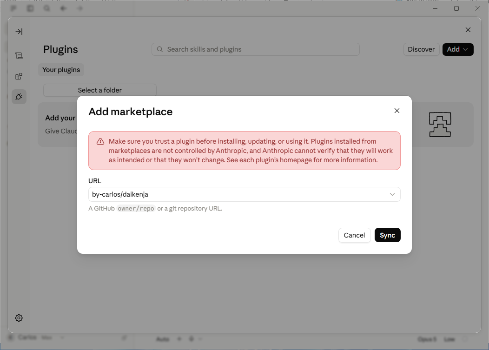
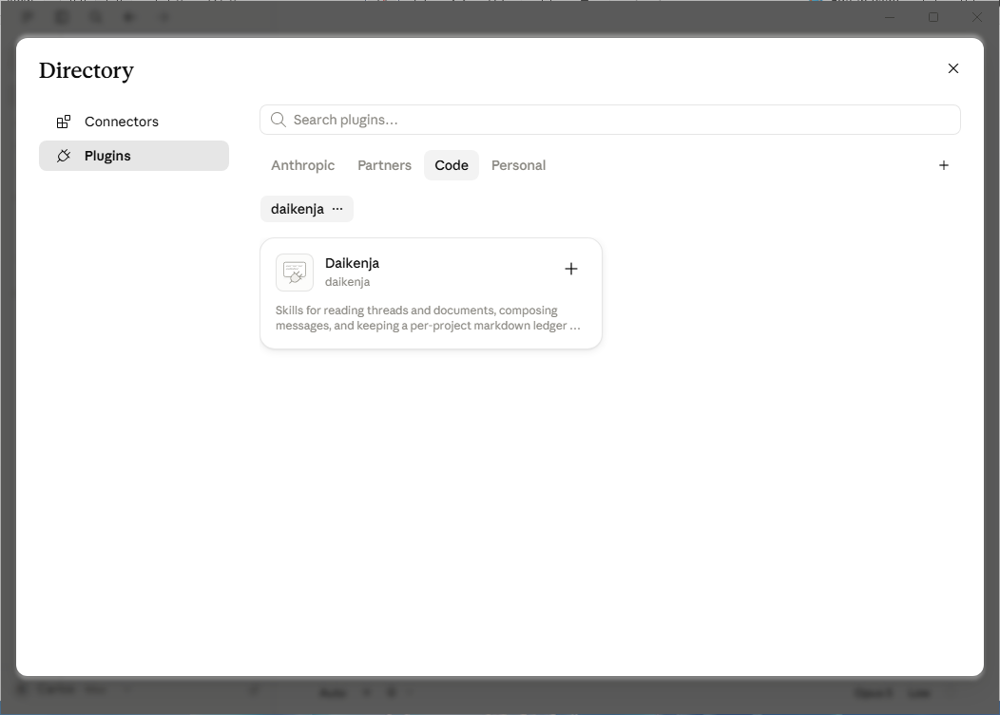

# Install and update

[Home](../../README.md) · **Install** · [Commands](commands.md) · [Writing](writing.md) · [Ledger](ledger.md) · [Reviewing](reviewing.md) · [Tensei](tensei.md) · [Your data](your-data.md) · [Slack bot](slack-bot.md) · [FAQ](faq.md) · [Why](why.md)

> **In short:** it runs only in Claude Code -- a local session in the Desktop
> app's **Code** tab, or the command line. Install from the Desktop app's
> **Plugins** pane or with two commands, then run `/daikenja:setup-user` once.
> `/daikenja:setup-project` is optional and adds per-project extras.

## Where it runs

**Claude Code** is the part of Claude that works with files on your computer.
You reach it through the **Code** tab of the Claude Desktop app, or the
`claude` command line (the CLI). Daikenja is a Claude Code plugin, so it
appears only there.

| Where | Runs Daikenja? |
|---|---|
| Claude Desktop app, **Code** tab, **local** session | Yes |
| Claude Code command line, on your machine or over SSH | Yes |
| Claude Desktop app, **Code** tab, **cloud** session | No -- a cloud session loads plugins from your claude.ai account, not from your machine |
| Claude Desktop app, **Chat** or **Cowork** tab | No |
| claude.ai in a browser | No |

## Install

Daikenja is listed on the shared
[`by-carlos/claude-plugins`](https://github.com/by-carlos/claude-plugins)
marketplace, and the Daikenja repository is also a marketplace of its own. The
steps below add the Daikenja repository directly, so you do not need the shared
catalog.

### Claude Desktop app

No terminal needed. Open the **Plugins** pane (the **+** button next to the
message box, then **Plugins**) and click **Add**. Put `by-carlos/daikenja` in
the **URL** box -- it takes a GitHub `owner/repo` directly, so there is nothing
else to paste -- then click **Sync**.



The plugin directory opens on its own once the sync finishes. Switch to its
**Code** tab, find the Daikenja card and click the **+** beside it.



The same **Plugins** pane is where you later enable, disable or remove it.

### Command line

From inside a session:

```
/plugin marketplace add by-carlos/daikenja
/plugin install daikenja@daikenja
```

Or from your shell, without starting a session first:

```bash
claude plugin marketplace add by-carlos/daikenja
claude plugin install daikenja@daikenja
```

## After installing

**Open a session.** In the Desktop app, go to the **Code** tab and start a new
**local** session. It asks for a folder to work in: pick a project's folder, or
a new empty folder you made for the purpose -- not your home folder itself. On
the command line, run `claude`. Type `/daikenja` in the message box: the list
that appears is your sign the install worked.

**Run `/daikenja:setup-user`, once per person.** It checks the environment,
asks a few questions about you, and writes your settings into a `daikenja`
folder inside `.claude` in your home directory. You can re-run it any time.
After this, every skill works.

**`/daikenja:setup-project` is optional, once per project.** A **project** is
any body of work you want a running record for: a launch, a client, a
programme, a repository. Every project lives in a git repository. Without
registering, `/daikenja:project-log` still works -- it creates the
[ledger files](ledger.md#what-it-looks-like) in the folder you are in the first
time you log something, asking first if that folder is not a git repository.
Registering adds:

- reaching the project by name from any folder;
- one project spanning several repositories, with one of them as its home;
- the catch-up checkpoint, so `project-catchup` shows only what is new to you;
- a project card, and seeding the ledger from a decision log, ADRs, a wiki
  space or a Slack channel you already have -- paste the text if your session
  is not connected to that tool. Seeding proposes entries and hands them to
  `project-log` for your yes; it never writes the ledger itself.

### A project that is not code

A project that lives in Slack, a wiki and meetings still gets a folder:
projects without a folder are gone. Run `/daikenja:setup-project` from the
folder you keep its notes in; if that folder is not a git repository, it
offers to run `git init` there first. If you have no folder for it at all, it
offers to make one named after the project, such as `atlas-launch`. Nothing
has to be pushed anywhere: a local repository stays on your machine, and git
keeps the ledger's history there.

From then on, add the name to any reading command --
`/daikenja:project-summary atlas-launch` -- from any session.

## Updating

New versions ship on the `release` branch. Updating never touches your
settings, notes or ledgers: they live outside the plugin's own folder. A
release that changes how a ledger is kept tells you, and the change waits for
your yes -- see [Do I have to re-run setup?](#do-i-have-to-re-run-setup).

| You use | How to update |
|---|---|
| **Desktop app** | Open the **Plugins** pane and select Daikenja: its page shows your version and an **Update** button. If it shows a version behind the latest [release](https://github.com/by-carlos/daikenja/releases), remove Daikenja there and install it again: a reinstall always lands on the current version, and your settings stay. |
| **Command line** | Run `/plugin`, open **Marketplaces**, select Daikenja, and choose **Update marketplace** -- or turn on **Enable auto-update** once, and Claude Code refreshes it in the background shortly after each session starts. |

**Do not count on the Desktop app noticing a new release.** It has no
auto-update toggle, and has been seen to report nothing for days after a
release, so the reinstall is the dependable route there.

On the command line, check auto-update is actually on: Claude Code enables it
by default for Anthropic's own marketplaces, not necessarily for others. The
same updates from your shell:

```bash
claude plugin marketplace update
claude plugin update daikenja
```

Either way, a new version does not load into a session that is already
running: start a new session, or run `/reload-plugins`.

### Do I have to re-run setup?

Usually not. Most releases change nothing already on your disk, and Daikenja
tells you when one does: every skill that reads your settings compares the
version that wrote them against the version installed, and prints a single line
when there is something to do:

```
daikenja.yaml was written by Daikenja 0.6.0; 0.7.0 is installed -- run /daikenja:setup-user.
```

When you see that line, run `/daikenja:setup-user`: it proposes the exact edits
and waits for your approval. A project still on the old single-file ledger is
reported as needing migration; `setup-user` lists it with the command that
migrates it -- see
[Moving from the old ledger](ledger.md#moving-from-the-old-ledger). Without that line there is nothing to do after an
update. The notice stays quiet for releases that need nothing, so it does not
become something you learn to skip. [Upgrading](../upgrading.md) is the same
information written out to apply by hand, newest version first.

## When plain words do not start a skill

*Advanced -- skip this unless it happens to you.*

Typing `/daikenja:<skill>` always works. Six skills can also start from plain
words ([which ones](commands.md)), but only while Claude Code has room to read
their descriptions. With many plugins installed on a smaller-context model, it
falls back to skill names only, and plain words stop starting them.

The fix is the `skillListingBudgetFraction` setting in your Claude Code
`settings.json`, which gives skill descriptions more room; `0.03` was enough
for a full Daikenja install on a 200K-context model when this was measured. On
a 1M-context model nothing is cut. Daikenja's own six descriptions are well
under Claude Code's default budget, so the setting matters only when other
plugins fill the rest.
Background: [by-carlos/daikenja#199](https://github.com/by-carlos/daikenja/issues/199).
