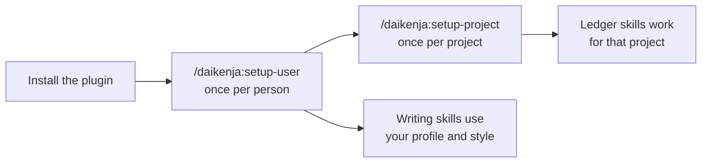

# Install and update

[Home](../../README.md) · **Install** · [Writing](writing.md) · [Ledger](ledger.md) · [Reviewing](reviewing.md) · [Tensei](tensei.md) · [Your data](your-data.md) · [Slack bot](slack-bot.md) · [FAQ](faq.md) · [Why](why.md)

> **In short:** install from the Claude Desktop app's **Plugins** pane or with
> two CLI commands, then run `/daikenja:setup-user` once and
> `/daikenja:setup-project` once per project. It runs only in Claude Code: the
> CLI or the Desktop app's **Code** tab.



The writing skills (`thread`, `compose`, `preflight`) do not need a
registered project; `setup-user` gives them your profile and writing style.
The ledger skills need the project registered with `setup-project`.

## Where it runs

| Where | Runs Daikenja? |
|---|---|
| Claude Code CLI, local or over SSH | Yes |
| Claude Desktop app, **Code** tab, local session | Yes |
| Claude Desktop app, **Code** tab, **cloud** session | Not a local install -- a cloud session loads plugins from your claude.ai account, not from your machine |
| Claude Desktop app, **Chat** or **Cowork** tab | No |
| claude.ai in a browser | No |

Daikenja is a Claude Code plugin, not a claude.ai skill, so it shows up only
where Claude Code runs.

## Install

Daikenja is listed on the shared
[`by-carlos/claude-plugins`](https://github.com/by-carlos/claude-plugins)
marketplace, and this repo is also a marketplace in its own right -- so you can
install it on its own, without adding anything else first.

### Claude Desktop app

No terminal needed. Open the **Plugins** pane (the **+** button next to the
prompt box, then **Plugins**) and click **Add**. Put `by-carlos/daikenja` in the
**URL** box -- it takes a GitHub `owner/repo` directly, so there is nothing else
to paste -- then click **Sync**.


The plugin directory opens on its own once the sync finishes. Daikenja is under
the **Code** tab, with a **+** beside it -- click that, and it is installed.


The same **Plugins** pane is where you later enable, disable or remove it.

### Claude Code CLI

From inside a session:

```
/plugin marketplace add by-carlos/daikenja
/plugin install daikenja@daikenja
```

Or from your shell, without starting a session first:

```bash
claude plugin marketplace add by-carlos/daikenja
claude plugin install daikenja@daikenja
```

## After installing

**`/daikenja:setup-user`**, once per person. It checks the environment, writes
your configuration into `~/.claude/daikenja/`, and captures your profile. It
does not register a project. You can re-run it any time.

**`/daikenja:setup-project`**, once per project, from inside it. It registers
the directory you are in, offers that project's own settings, and can seed its
ledger from a decision log, a wiki space or a Slack channel you already have.
Seeding proposes entries and hands them to `/daikenja:project-log` for your
approval; it never writes the ledger itself.

A project does not have to be one directory -- see
[The project ledger](ledger.md#one-project-many-places).

## Updating

New versions ship on the `release` branch. A new version does not load into a
session that is already running: restart Claude Code, or run
`/reload-plugins`.

### Claude Code CLI -- the dependable route

Run `/plugin` and open the **Marketplaces** tab. Selecting the Daikenja
marketplace gives you **Update marketplace** for a one-off, and **Enable
auto-update**, which has Claude Code refresh the marketplace and its installed
plugins in the background shortly after each session starts. That tab also
tells you which state you are in.

Turn auto-update on, and check rather than assume: Claude Code enables it by
default for Anthropic's own marketplaces, not necessarily for others.

The same two actions from your shell:

```bash
claude plugin marketplace update
claude plugin update daikenja
```

### Claude Desktop app

Open the **Plugins** pane and select Daikenja. Its page shows the version you
have, how many skills it ships, and an **Update** button.

**Do not count on the Desktop app noticing a new release.** In testing, a
plugin sat on an old version across a release, with **Update** inactive and
**Check for updates** reporting nothing available, days after the new version
was out. The Desktop app has no auto-update toggle either.

If the page shows a version behind the one you expect, remove Daikenja and
install it again -- a reinstall always lands on the current version.

### Do I have to re-run setup?

Usually not. Most releases change nothing already on your disk, and Daikenja
tells you when one does: every skill that reads your configuration compares the
version that wrote it against the version installed, and prints a single line
when there is something to do:

```
daikenja.yaml was written by Daikenja 0.6.0; 0.7.0 is installed -- run /daikenja:setup-user.
```

When you see that line, run `/daikenja:setup-user`: it proposes the exact edits
and waits for your approval. Otherwise ignore updating. The notice stays quiet
for releases that need nothing, so it does not become something you learn to
skip. [Upgrading](../upgrading.md) is the same information written out to apply
by hand, newest version first.

## When plain language does not start a skill

**Typing `/daikenja:<skill>` always works, on every model.** Claude Code can
also start a skill from plain language ("help me answer this" starting
`/daikenja:thread`), but only for the six skills that allow it, and only if it
has room to read their descriptions.

On a smaller-context model, a full Daikenja install plus a few other plugins
can be more than Claude Code has room for. It then falls back to skill *names*
only, and plain-language triggering stops working. Use the slash form, or raise
`skillListingBudgetFraction` in your Claude Code settings to give skill
descriptions more room.

Daikenja's own six descriptions come to about 2,000 characters (measured
3 Nov 2026), well under Claude Code's 8,000-character default budget, so the
setting matters only when other plugins fill the rest. Background:
[by-carlos/daikenja#199](https://github.com/by-carlos/daikenja/issues/199).
