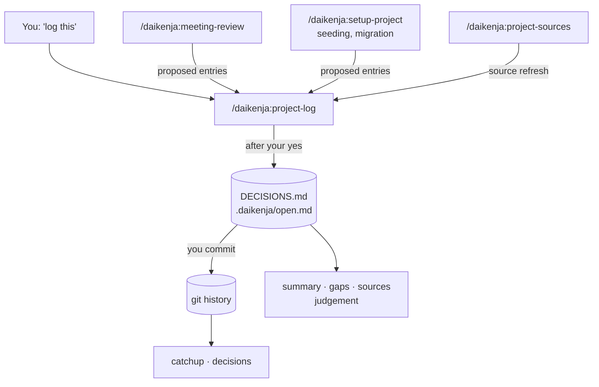

# The project ledger

[Home](../../README.md) · [Install](install.md) · [Commands](commands.md) · [Writing](writing.md) · **Ledger** · [Reviewing](reviewing.md) · [Tensei](tensei.md) · [Your data](your-data.md) · [Slack bot](slack-bot.md) · [FAQ](faq.md) · [Why](why.md)

> **In short:** a project's ledger is two plain text files in its git
> repository: `DECISIONS.md`, the decisions still in force, and
> `.daikenja/open.md`, what is still open. They say what is true now; git keeps
> the history. Only `project-log` writes them, only after you say yes, and it
> never commits. Five commands read them back -- what changed, the full
> picture, one decision's history, what nobody owns, which sources moved --
> and a sixth lists your projects.



## What it looks like

Both files are Markdown -- plain text with a little formatting, readable in any
text editor or on GitHub.

**`DECISIONS.md`** sits at the root of the repository and lists the decisions
still in force, grouped by area. Each entry is the rule, why, and what would
reopen it:

```markdown
## Rollout

Paths: `deploy/`

- **Roll the beacon service out region by region, not all at once.** — one
  bad region must not take down every customer. Revisit: if the canary
  checks become automatic.
```

**`.daikenja/open.md`** lists what is still open, one dated line each, with an
owner's handle (`@name`, or `@unassigned`), plus the project's context links
and tracked sources:

```markdown
## Open items

- 2026-08-15 -- @diablo -- Confirm the canary region for the rollout.
- 2026-08-14 -- @unassigned -- Decide who is on call during the region rollout.
```

(The names above are invented.) There are no IDs. When a decision changes, its
entry is rewritten; when an item is closed, its line is deleted. The old
wording is not lost: it is in git, and `project-decisions` and
`project-catchup` read it from there. The exact formats are
[`decisions-format.md`](../decisions-format.md), shared with other tools that
write `DECISIONS.md`, and [`open-format.md`](../open-format.md).

**Where it lives.** Every project lives in a git repository. `DECISIONS.md` is
at the root of each repository the project spans, beside the code it
constrains: it is the *why* behind the code, which `git blame` cannot give you.
`open.md` is in the project's **home** repository, the one registered first.
If a repository already has a `DECISIONS.md` -- written by hand or by another
tool -- Daikenja adopts it and adds to it; it never replaces it.

**Everyone who can read the repository can read its ledger.** Write entries
for the team; see [Who can see what](your-data.md#who-can-see-what).

## Writing to it: `project-log`

Say "log this" or "record this decision", or run `/daikenja:project-log` from
one of the project's folders. From anywhere else, name the project:
`/daikenja:project-log atlas-migration`. It shows you every line it wants to
add, change or delete, grouped under the full path of the file each lands in,
and **waits for your yes**
before writing anything. It checks for duplicates, asks for the why and the
revisit condition when they are missing, attributes each open item to an
owner, and tells you when an owner's handle is new. The first time, it creates
the file from a template -- asking first if the folder is not a git repository,
and never in your home folder itself.

**It writes the files and never commits them.** Commit them yourself, on
whatever branch you work on, like any other change. Until you do,
`project-catchup` lists the edits as "not committed yet", so nothing is
invisible.

**It is the only skill that writes ledger content.** `meeting-review`,
`setup-project` seeding and migration, and `project-sources` propose entries
and hand them to `project-log`, so every line reaches you for approval the same
way.

After writing, it may offer to update a project document that a new entry
names, so the two agree. That happens only on your yes.

## Reading it back

| To... | Run | Takes a project name? |
|---|---|---|
| See what changed since you last checked | `/daikenja:project-catchup` | Yes |
| Get the full picture, for someone with no context | `/daikenja:project-summary` | Yes |
| Find what was decided about one topic, and how it got there | `/daikenja:project-decisions` | Yes |
| Find open items with no owner, or that have sat too long | `/daikenja:project-gaps` | Yes |
| See which tracked source documents moved since you read them | `/daikenja:project-sources` | Yes |
| List every project, and check which one you are standing in | `/daikenja:project-list` | No |

With a project name -- `/daikenja:project-summary atlas-migration` -- a command
reads that project from any folder. All six run only when you type them; "catch
me up" does not start them. A project spanning several repositories is read
across all of them: every repository's `DECISIONS.md`, each entry naming the
repository it came from.

**`project-catchup` reports only what changed** since your **checkpoint** --
the commit each repository was at when you last caught up, kept in your
settings, not in the ledger. It reads the change from git history, by current
wording, and also lists edits to the two files that are not committed yet.
After it reports, it asks before moving the checkpoint forward. If a checkpoint
commit is no longer in the history -- after a rebase, say -- that run is a
first run and says so. The checkpoint needs the project registered with
`setup-project`; without it, catch-up shows the whole ledger each time and says
why. For everything that is open right now, use `project-summary` or
`project-gaps`.

**`project-decisions` follows one topic through git:** the entry in force now,
and the earlier wording it replaced.

**`project-sources` is catch-up's mirror image:** catch-up reports what was
written into the ledger; sources reports what moved *outside* it -- the wiki
pages and documents the project is tracked from, compared against the
last-modified date recorded in `open.md`'s Sources section when you last read
them.

If a command answered about a project you did not expect, run
`/daikenja:project-list`.

## Notices you may see

- **"needs migration -- run /daikenja:setup-user".** The project still has a
  ledger in the old single-file format. See
  [Moving from the old ledger](#moving-from-the-old-ledger).
- **"was written by a newer format ... update the Daikenja plugin".** One of
  the files carries a format version newer than your plugin knows. Reading
  commands still read it and warn once; `project-log` refuses to write until
  you update, so it never damages a file it does not fully understand.

## One project, many repositories

A project does not have to be one repository. A programme spanning three
repositories is registered once with `/daikenja:setup-project`, which asks
which one is home, and every one of its folders resolves to it. Each
repository keeps its own `DECISIONS.md`; `open.md` lives in the home one.

**Projects without a folder are gone.** Every project now lives in a git
repository. For work that lives in Slack, a wiki and meetings, `setup-project`
offers a new folder named after the project, with `git init`; nothing has to be
pushed anywhere.

## Moving from the old ledger

Earlier versions kept one file, `.daikenja/ledger.md`, with IDs, replaced
decisions kept in place, and a Changelog. Daikenja no longer reads it. When a
skill says a project needs migration, run `/daikenja:setup-user`: it lists each
such project with the command for it, `/daikenja:setup-project <name>`.

That command shows the whole migration before writing anything: decisions
still in force become `DECISIONS.md` entries, open items, context links and
sources move to `open.md`, and replaced decisions, closed items and the
Changelog are dropped. The old ledger is kept as a dated backup beside itself,
such as `ledger.2026-11-03.bak.md`. A project that had no folder needs one: you
choose it, and by default it is a new folder with `git init`. Nothing is
committed; commit the result yourself. [Upgrading](../upgrading.md) has the
detail.

## The project card

Beside `open.md`, a project can have a short **project card** --
`.daikenja/project.md` in the home repository: what the project is about,
which channels, repositories and trackers belong to it, and who is on it.
`setup-project` offers to write one. It is optional, but it lets `thread` and
`judgement` work out which project a pasted thread belongs to from what it
says, not only from the folder you are in. Format:
[`project-card.md`](../project-card.md).
