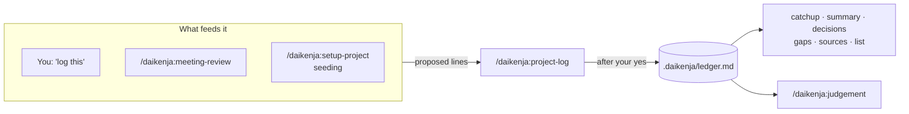

# The project ledger

[Home](../../README.md) · [Install](install.md) · [Writing](writing.md) · **Ledger** · [Reviewing](reviewing.md) · [Tensei](tensei.md) · [Your data](your-data.md) · [Slack bot](slack-bot.md) · [FAQ](faq.md) · [Why](why.md)

> **In short:** the ledger is a plain markdown file in the project that records
> what was decided and what is still open, one dated line each. Only
> `project-log` writes it, and only after you say yes. Six skills read it back:
> what changed, the full picture, one decision's history, what nobody owns.



## What it looks like

A ledger is ordinary Markdown, newest first, readable without Daikenja:

```markdown
## Decisions

- 2026-08-13 -- D-004 -- @rimuru -- Supersedes D-002. Roll the beacon service out region by region, not all at once.
- 2026-07-20 -- D-002 -- @rimuru -- Roll the beacon service out to every region at once. -> superseded by D-004

## Open items

- [ ] 2026-08-15 -- O-005 -- @diablo -- Confirm the canary region for the rollout.
- [ ] 2026-08-14 -- O-004 -- @unassigned -- Decide who is on call during the region rollout.
```

Each line is a date, an ID (`D-` for a decision, `O-` for an open item), an
owner and what was settled. A decision that replaces another says so, and the
old one is marked rather than deleted, so the history stays readable. The
format is specified in [`ledger-format.md`](../ledger-format.md).

In a codebase, the ledger is the *why* behind the code -- the part `git blame`
cannot give you. It sits in the project at `.daikenja/ledger.md` by default,
so git versions it beside the code and reviews it in the same pull requests.

## Writing to it: `project-log`

Say "log this" or "record this decision", or run `/daikenja:project-log`. It
shows you the exact lines it wants to add and **waits for your yes** before
writing anything. It checks for duplicates, attributes each line to an owner,
and tells you when a handle is new to the ledger.

**It is the only skill that writes ledger content.** `meeting-review` and
`setup-project` seeding both propose lines and hand them to `project-log`, so
every line still reaches you for approval the same way.

## Reading it back

| To... | Run |
|---|---|
| See what changed since you last checked | `/daikenja:project-catchup` |
| Get the full picture, for someone with no context | `/daikenja:project-summary` |
| Find what was decided about one topic, and what replaced it | `/daikenja:project-decisions` |
| Find open items with no owner, or that have sat too long | `/daikenja:project-gaps` |
| See which tracked source documents moved since you read them | `/daikenja:project-sources` |
| List every project, and check which one you are standing in | `/daikenja:project-list` |

**`project-catchup` moves a checkpoint.** After it reports, it asks before
recording that you are now up to date, so the next catch-up starts from there.
It never touches the ledger itself.

**`project-sources` is its mirror image:** `project-catchup` reports what was
written into the ledger, `project-sources` reports what moved *outside* it --
the wiki pages and documents the project is tracked from.

The five reading skills take an **optional project name**:
`/daikenja:project-summary atlas-migration` reads that project from anywhere.
They all run only when you type the command; a phrase such as "catch me up"
does not start them.

If a reading skill answered about a project you did not expect, run
`/daikenja:project-list`: it shows which project your current directory
resolves to and whether each ledger actually exists.

## One project, many places

A project does not have to be one directory. A programme spanning three
repositories is registered once, and every one of its directories resolves to
it. A body of work with no repository at all is registered with no directory,
reached by name, and keeps its ledger wherever its `ledger:` setting points.

## The project card

Beside the ledger, a project can have a short **project card**
(`.daikenja/project.md`): what the project is about, which channels,
repositories and trackers belong to it, and who is on it. `setup-project`
offers to write one. It is optional, but it lets `thread` and `judgement` work
out which project a pasted thread belongs to from what it says, not only from
the directory you are in. Format: [`project-card.md`](../project-card.md).
