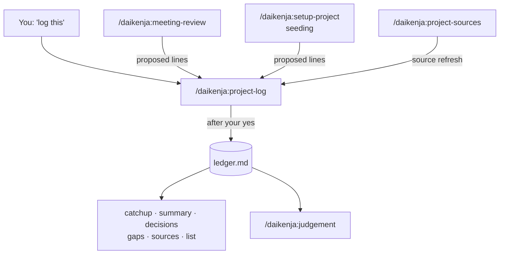

# The project ledger

[Home](../../README.md) · [Install](install.md) · [Commands](commands.md) · [Writing](writing.md) · **Ledger** · [Reviewing](reviewing.md) · [Tensei](tensei.md) · [Your data](your-data.md) · [Slack bot](slack-bot.md) · [FAQ](faq.md) · [Why](why.md)

> **In short:** the ledger is a plain text file that records what a project
> decided and what is still open, one dated line each. Only `project-log`
> writes to it, and only after you say yes. Six commands read it back: what
> changed, the full picture, one decision's history, what nobody owns, which
> sources moved, and which project you are in.



## What it looks like

A ledger is a Markdown file -- plain text with a little formatting, readable
in any text editor or on GitHub. Newest first:

```markdown
## Decisions

- 2026-08-13 -- D-004 -- @rimuru -- Supersedes D-002. Roll the beacon service out region by region, not all at once.
- 2026-07-20 -- D-002 -- @rimuru -- Roll the beacon service out to every region at once. -> superseded by D-004

## Open items

- [ ] 2026-08-15 -- O-005 -- @diablo -- Confirm the canary region for the rollout.
- [ ] 2026-08-14 -- O-004 -- @unassigned -- Decide who is on call during the region rollout.
```

Each line is a date, an ID (`D-` for a decision, `O-` for an open item), an
owner's handle (`@name`, or `@unassigned`) and what was settled. An open item
has a checkbox, ticked when it is resolved. A decision that replaces another
says so, and the old one is marked rather than deleted, so the history stays
readable. (The names above are invented.) The exact format is in
[`ledger-format.md`](../ledger-format.md).

**Where it lives.** By default at `.daikenja/ledger.md` in the project's
folder. In a code repository, git then versions it beside the code: it is the
*why* behind the code, which `git blame` cannot give you. A project with no
folder keeps it wherever you choose -- see
[One project, many places](#one-project-many-places).

## Writing to it: `project-log`

Say "log this" or "record this decision", or run `/daikenja:project-log`. It
shows you the exact lines it wants to add and **waits for your yes** before
writing anything. It checks for duplicates, attributes each line to an owner,
and tells you when an owner's handle is new to the ledger. The first time, it
creates the file.

**It is the only skill that writes ledger content.** `meeting-review`,
`setup-project` seeding and `project-sources` propose lines and hand them to
`project-log`, so every line reaches you for approval the same way.

After writing, it may offer to update a project document that a new line
names, so the two agree. That happens only on your yes.

## Reading it back

| To... | Run | Takes a project name? |
|---|---|---|
| See what changed since you last checked | `/daikenja:project-catchup` | Yes |
| Get the full picture, for someone with no context | `/daikenja:project-summary` | Yes |
| Find what was decided about one topic, and what replaced it | `/daikenja:project-decisions` | Yes |
| Find open items with no owner, or that have sat too long | `/daikenja:project-gaps` | Yes |
| See which tracked source documents moved since you read them | `/daikenja:project-sources` | Yes |
| List every project, and check which one you are standing in | `/daikenja:project-list` | No |

With a project name -- `/daikenja:project-summary atlas-migration` -- a command
reads that project from any folder. All six run only when you type them; "catch
me up" does not start them.

**`project-catchup` reports only what changed** since your **checkpoint** --
the date you last caught up, kept in your settings, not in the ledger. After it
reports, it asks before moving the checkpoint forward. For everything that is
open right now, use `project-summary` or `project-gaps`.

**`project-sources` is its mirror image:** catch-up reports what was written
into the ledger; sources reports what moved *outside* it -- the wiki pages and
documents the project is tracked from, compared against the last-modified date
recorded when you last read them.

If a command answered about a project you did not expect, run
`/daikenja:project-list`.

## One project, many places

A project does not have to be one folder.

- **Several folders.** A programme spanning three repositories is registered
  once with `/daikenja:setup-project`, and every one of its folders resolves to
  it. Its ledger lives in the first folder registered.
- **No folder at all.** A body of work that lives in Slack, a wiki and
  meetings is registered with no directory and reached by name. Its ledger
  goes where you choose; `setup-project` suggests
  `ledgers/<project name>.md` in your own Daikenja folder.

## The project card

Beside the ledger, a project can have a short **project card** -- `project.md`
in the same folder: what the project is about, which channels, repositories
and trackers belong to it, and who is on it. `setup-project` offers to write
one. It is optional, but it lets `thread` and `judgement` work out which
project a pasted thread belongs to from what it says, not only from the folder
you are in. Format: [`project-card.md`](../project-card.md).
