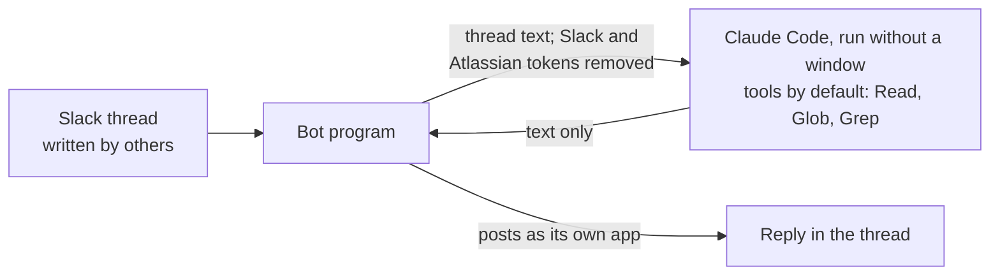

# The Slack bot (optional)

[Home](../../README.md) · [Install](install.md) · [Commands](commands.md) · [Writing](writing.md) · [Ledger](ledger.md) · [Reviewing](reviewing.md) · [Tensei](tensei.md) · [Your data](your-data.md) · **Slack bot** · [FAQ](faq.md) · [Why](why.md)

> **In short:** a small program you run yourself, so you can get a thread
> summarised or checked against your ledgers without leaving Slack. One
> person's bot, not a shared team bot. Needs your own Slack app, Python, and
> some comfort with a command line.

## What it does

Mention it in a thread and it replies in that thread:

```
@daikenja summary     what this thread is asking, what is open, who it waits on
@daikenja judgement   that thread checked against your ledgers and general knowledge
@daikenja delete      takes down the bot's own last post in the thread
```

`summary` and `judgement` also take a Slack, Confluence or Jira link and work
on that instead, still answering in the thread you asked from. If you set one
up, a custom emoji reaction on a message runs both at once.

It runs on your machine, uses your ledgers and never anyone else's, and by
default only you can trigger it. It never drafts a reply and never writes your
ledger. `judgement` may quote your ledger lines in its reply, which everyone in
the thread then sees.

## What it reads, and where it goes

- **Slack:** threads it is mentioned or reacted on, in channels it was invited
  to and in direct or group messages it is added to. The scopes are listed in
  [`bot/README.md`](../../bot/README.md); drop the direct-message ones if you
  do not want that.
- **Claude (Anthropic):** the thread text and any linked pages, processed
  under your Claude account's terms.
- **Confluence and Jira:** pages and issues it is pointed at, plus those they
  link to, one hop deep. The bot program fetches them -- not the model -- with
  one Atlassian token you supply, so it sees whatever that account sees.
- **Its log file**, if you give it one with `--log-file`, can hold model
  output derived from thread text. Keep it somewhere only you can read.

**You own the Slack app and the tokens.** Your workspace admin may need to
approve the app. Since the bot sends other people's messages to Claude, check
your workplace's policy before using it on threads with colleagues, especially
private channels and direct messages.

## What limits the damage



**The model cannot post.** The bot runs Claude Code without a window to write
the text. It removes the Slack and Atlassian tokens, and any setting whose name
starts with `SLACK`, from that process's environment, and limits its tools to
reading files. Only the bot program posts.

**What it does not prevent.** Text planted in a thread could still steer the
model to read a file it can reach and put its contents into the reply. Narrow
that:

- set `claude.working_dir` to a folder holding only your ledgers, not your
  whole home folder (the default);
- keep other secrets out of the environment the bot runs in;
- keep its tokens in environment variables or token files outside that
  folder -- a token written into `bot.yaml` sits where the model can read it
  by default;
- leave `claude.allowed_tools` at its read-only default.

## Setting it up

Installing the plugin downloads the bot's code and does not run it.
[`bot/README.md`](../../bot/README.md) has the Slack app manifest and scopes,
the configuration, running it in the background on Windows, Linux or macOS,
and the tests.
