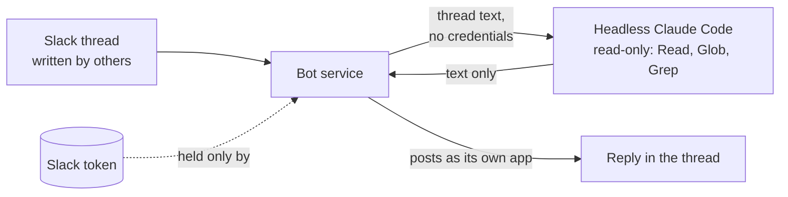

# The Slack bot (optional)

[Home](../../README.md) · [Install](install.md) · [Writing](writing.md) · [Ledger](ledger.md) · [Reviewing](reviewing.md) · [Tensei](tensei.md) · [Your data](your-data.md) · **Slack bot** · [FAQ](faq.md) · [Why](why.md)

> **In short:** a small Python service you run yourself, so a thread gets a
> Daikenja summary or judgement without anyone leaving Slack. It posts as its
> own Slack app, never as you, and answers only from your own ledgers. Nothing
> runs unless you set it up.

## What it does

Mention it in a thread and it replies in that thread:

```
@daikenja summary     what this thread is asking, what is open, who it waits on
@daikenja judgement   that thread checked against your project's ledger
@daikenja delete      takes down the bot's own last post in the thread
```

`summary` and `judgement` also take a Slack, Confluence or Jira link and work
on that instead, still answering in the thread you asked from. Pages and
issues the subject links to are read too, one hop deep.

**It is a personal instance.** It runs on your machine, reads your ledgers,
and posts as its own Slack app -- never as you, and never with anybody
else's records. By default only you can trigger it.

**It never drafts a reply and never writes your ledger.** `summary` gathers,
`judgement` judges; recording a decision still happens in a session of your
own, through `/daikenja:project-log`.

## Why it is safe to point at other people's threads



**The model never holds the Slack token.** The bot runs Claude Code headless
to produce the text, with every credential stripped out of that process's
environment and its tools limited to reading files. A separate layer that the
model cannot reach does the posting.

That matters because thread content is written by other people. A model that
could both read it and post would be one instruction away from posting
somewhere it should not.

## Setting it up

Installing the plugin downloads `bot/` and does not run it. Setup takes a
Slack app of your own, a config file and Python:
[`bot/README.md`](../../bot/README.md) has the Slack app manifest, the scopes,
the configuration, running it in the background on Windows, Linux or macOS,
and the tests.
