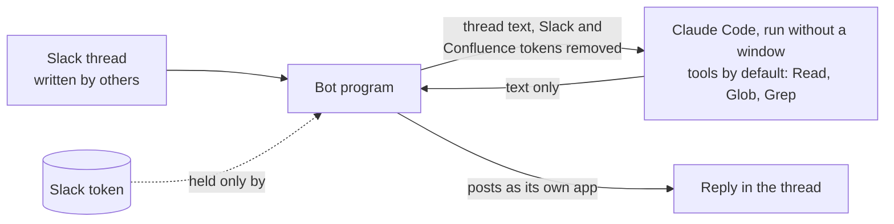

# The Slack bot (optional)

[Home](../../README.md) · [Install](install.md) · [Commands](commands.md) · [Writing](writing.md) · [Ledger](ledger.md) · [Reviewing](reviewing.md) · [Tensei](tensei.md) · [Your data](your-data.md) · **Slack bot** · [FAQ](faq.md) · [Why](why.md)

> **In short:** a small program you run on your own machine, so you can get a
> thread summarised or checked against your ledgers without leaving Slack. It
> is one person's bot, not a shared team bot, and it posts as its own Slack
> app, never as you. Setting it up needs your own Slack app, Python, and some
> comfort with a command line.

## What it does

Mention it in a thread and it replies in that thread:

```
@daikenja summary     what this thread is asking, what is open, who it waits on
@daikenja judgement   that thread checked against your ledgers and general knowledge
@daikenja delete      takes down the bot's own last post in the thread
```

`summary` and `judgement` also take a Slack, Confluence or Jira link and work
on that instead, still answering in the thread you asked from. The bot fetches
the linked pages and issues itself -- one hop deep -- and hands their text to
the model.

**It is a personal instance.** It runs on your machine, reads only your own
ledgers, and by default only you can trigger it. It never drafts a reply and
never writes your ledger; recording a decision still happens in a session of
your own, through `/daikenja:project-log`.

## What limits the damage



**The model cannot post.** The bot runs Claude Code without a window to
produce the text. It removes the Slack and Confluence tokens, and any setting
whose name starts with `SLACK`, from that process's environment, and limits
its tools to reading files. Only the bot program, which the model cannot reach,
posts to Slack.

That matters because thread content is written by other people, and a model
that could both read it and post would be one instruction away from posting
somewhere it should not.

**What it does not prevent.** Text planted in a thread could still steer the
model to read a file it can reach and put its contents into the reply. Narrow
that:

- set `claude.working_dir` to a folder holding only your ledgers, not your
  whole home folder (the default);
- keep other secrets out of the environment the bot runs in, and keep its
  tokens out of files the model could read;
- leave `claude.allowed_tools` at its read-only default.

## What it reads, and where it goes

- **Slack:** the threads it is mentioned in, in channels it was invited to.
  Everyone in the thread sees its reply.
- **Claude (Anthropic):** the thread text and any linked pages, processed
  under your Claude account's terms.
- **Confluence and Jira:** pages and issues it is pointed at, read with an
  Atlassian token you supply -- so it sees whatever that account sees.

**You own the Slack app and the tokens.** Your workspace admin may need to
approve the app. Since the bot sends other people's messages to Claude, check
your workplace's policy before using it on threads with colleagues, especially
in private channels.

## Setting it up

Installing the plugin downloads the bot's code and does not run it.
[`bot/README.md`](../../bot/README.md) has the Slack app manifest and scopes,
the configuration, running it in the background on Windows, Linux or macOS,
and the tests.
