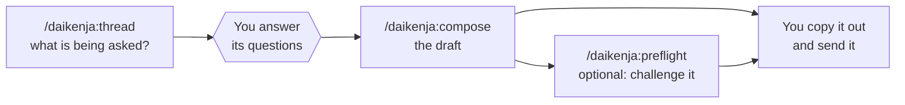

# Writing a reply

[Home](../../README.md) · [Install](install.md) · **Writing** · [Ledger](ledger.md) · [Reviewing](reviewing.md) · [Tensei](tensei.md) · [Your data](your-data.md) · [Slack bot](slack-bot.md) · [FAQ](faq.md) · [Why](why.md)

> **In short:** `thread` works out what a thread is asking and what you need to
> decide, `compose` writes the message, and `preflight` challenges a draft you
> cannot afford to get wrong. None of them sends anything. Two more skills
> teach Daikenja how you write and how the people you write to read.

## Understand the thread first: `thread`

`/daikenja:thread` reads a Slack or email thread -- a link or pasted text --
and tells you what is being asked and by whom, and who is waiting on what. Then
it asks you what only you know: what you have already promised, what you will
not commit to.

**It does not draft.** That is the point: a reply drafted before you have said
where you stand is a reply in someone else's words.
`/daikenja:thread message` produces the same summary written for a channel
rather than for you, with people named instead of "you".

## Draft or rewrite: `compose`

`/daikenja:compose` drafts a work message, or rewrites one you wrote, for
Slack, Teams or email. It keeps it clear, calm and easy to read **without
changing the ask, the stance or your confidence level**. Afterwards you can ask
for a firmer or a softer version; the ask, the owner and the timing stay the
same either way.

For a request, it first runs the same six substance checks as `preflight`
(below), so a message that asks the wrong person, or asks something already
settled, is flagged before it is polished.

## Challenge a draft before it goes out: `preflight`

`/daikenja:preflight` is for the message you cannot afford to get wrong. It
runs in three passes:

1. **Substance checks.** Six questions every request has to pass: enough
   context to act on, what you already tried, the options framed, one
   specific question, the right person, and not already answered elsewhere.
2. **Reviewers.** It puts the draft in front of several readers, each looking
   for a different failure: the busy reader, the fact-checker, the risk reader,
   the executive, the tone-sensitive reader, and others. Any colleague you
   have described to Daikenja joins them.
3. **Rewrite.** It fixes the wording problems they raise and hands back a
   revised draft, plus the facts only you can supply.

**It changes wording, never content.** If a fix would need a fact the draft
does not have, it asks you instead of inventing one. The reviewers and their
rules are in [`reviewer-personas.md`](../reviewer-personas.md); the six checks
in [`substance-checks.md`](../substance-checks.md).

## Teach it how you write: `learn-voice`

Out of the box, Daikenja drafts in a plain, calm default voice
([`voice.md`](../voice.md)). `/daikenja:learn-voice` replaces the parts of it
you would write differently, by working out your style from samples you
supply.

- It reads only samples you say you wrote yourself.
- It records style, never facts about people or projects.
- It backs up your current `writing-style.md` to a dated copy, then writes the
  whole file.
- What it noticed but kept out of the file comes back as a separate "what to
  watch" report, saved so the next run can show what moved.

Run it whenever you have more samples, not only at setup.

## Remember how someone reads: `remember-persona`

A **persona**, in Daikenja, is your notes on one real person you write to: "S
challenges every technical claim", "the director reads only the first line".
Say it while drafting, or run `/daikenja:remember-persona`, and later drafts
and `preflight` reviews are written for that reader.

It is the only skill that writes persona notes. They stay in your own files --
see [Where your data lives](your-data.md) for where, and who can see them.
